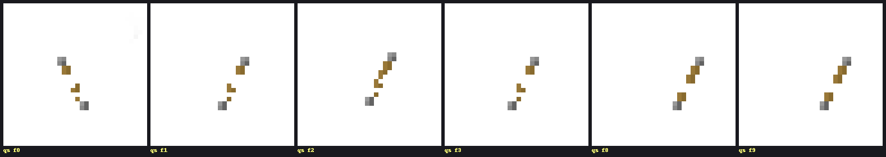
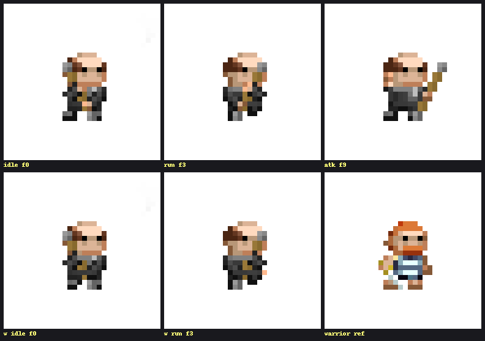
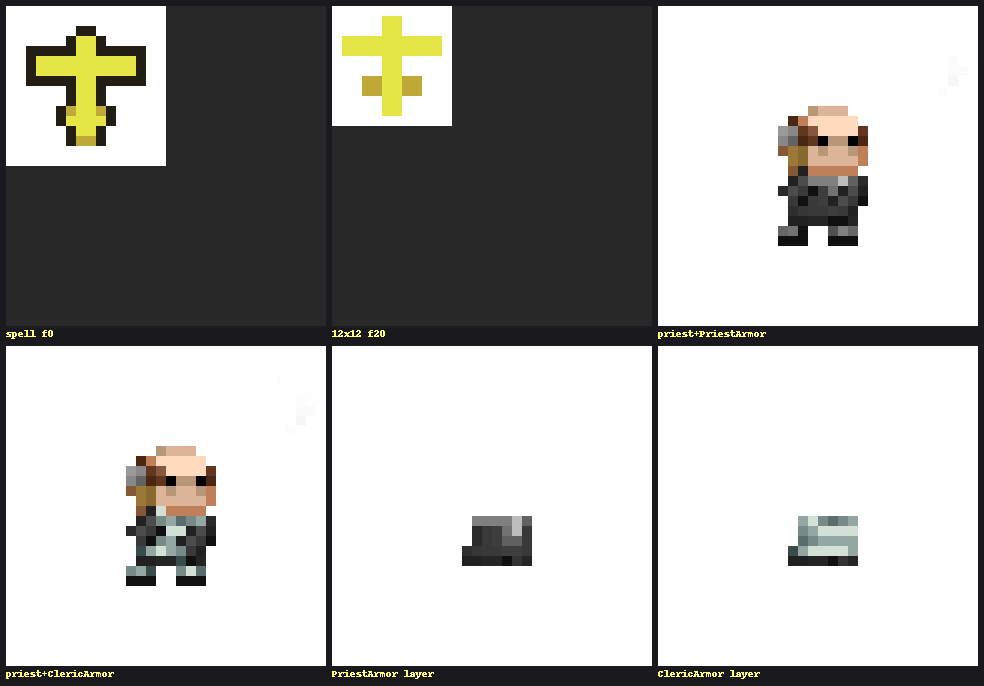
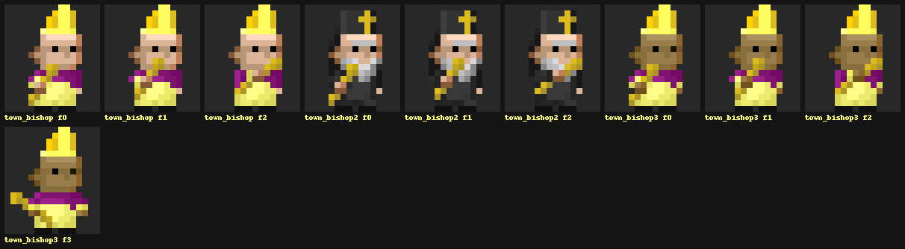
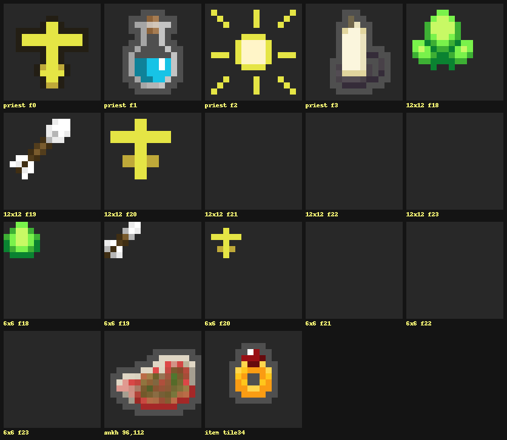
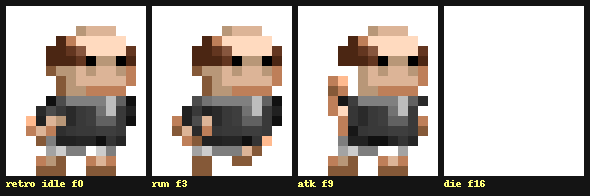
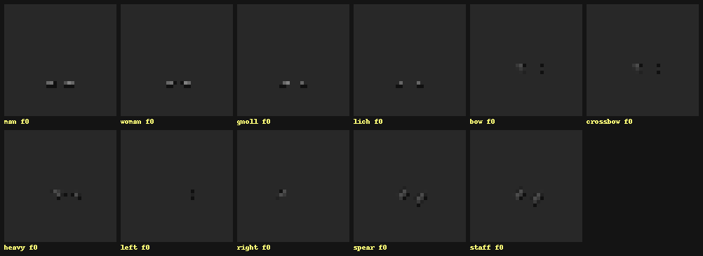
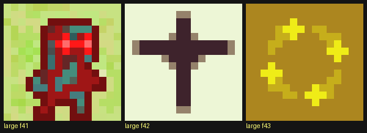

# Priest graphics asset review — 2026-11-09

Full inventory of priest- and BishopNPC-specific graphics reachable on master (after 094e26740),
reviewed at magnification with pixel-level checks. Weak items are marked **WEAK** with priority.

All paths relative to `RemixedDungeon/src/main/assets/`.

## Bug

### [P1] Quarterstaff idle frame has a stray floating blob
`hero_modern/items/Quarterstaff_right.png`, frame 0: a 17px gray "+" cluster in the top-right
corner of the frame. The priest idle loop plays f0/f1 constantly, so the blob floats beside the
hero at all times (quarterstaff is the priest starting weapon; any quarterstaff wielder is
affected). Other weapon sheets (Wand, Sword, Mace) have clean corners — unique to this file.
Fix: erase the cluster in f0 (no other frame has it).

## Weak assets

### [P2] Modern vestment overlay is drab and low-contrast
`hero_modern/armor/PriestArmor.png` (19 frames, 32x32): a small gray robe patch
(bbox 13,17–20,22 — same footprint as every other class armor layer) drawn over the dark suit
of the body layer. Gray-on-dark-gray nearly vanishes in game, and the hero reads as "bald man in a suit",
not as the gold/cream vestment identity used by every other priest asset (spell icons, item
icon, Blessed buff, bishop NPC). Reference: the unused `hero_modern/armor/ClericArmor.png`
layer (teal/white, clearly reads as clergy) sits in the repo already.

Options: recolor the PriestArmor layer to the cream/gold of the item icon, or adopt/rename the
ClericArmor layer art.

### [P3] Affinity 12px cross lacks the dark outline
`ui/ui_icons12x12.png` frame 20 (Priest mastery icon, `WndHeroSpells`): flat yellow
(229,229,69 + 191,169,57 shade), no dark outline, while the neighboring affinity icons
(f18 Elf, f19 Huntress) carry a dark outline and the 16px spell cross has one. May wash out on
the light window chrome. Symmetry verified by pixel grid — correct.

### [P3] Bishop face reads mask-like
`mobs/town_bishop3.png` (the BishopNPC texture, 4 frames): silhouette and mitre are fine, but
the face is a heavy black band — looks like sunglasses/a mask at game zoom. Note
`mobs/town_bishop2.png` (dead asset, see below) has a much better face (white beard, defined
eyes) — a good donor for a rework.

### [P3] Retro helmet is a bare gray band
`hero/armor/helmet/PriestArmor.png`: a thin gray skullcap strip, barely distinguishable from
the head. Rarely visible (only with helmets), so low priority.

## Healthy assets

| Asset | Path | Notes |
|---|---|---|
| Spell icons ×6 | `spellsIcons/priest.png` | Blessing f0 (orthodox cross), Holy Water f1 (crucifer flask — bespoke rework 2026-11-09, was a restyle of the items.png:56 potion), Exorcism f2 (sunburst), Last Rites f3 (candle in brass holder + rays — bespoke rework 2026-11-09, was a byte-exact copy of the Mind Vision candle item `items/candle.png:0`), God's Wrath f4 (bolt), Anathema f5 (violet seal) — sheet widened 64→96 on 2026-11-09 for the wrath school. The fifth Priest-affinity spell, Heal, uses `spellsIcons/witchcraft.png`. All six frames runtime-verified via `/debug/lua_eval` in a live PRIEST game |
| Affinity icon 6px | `ui/ui_icons6x6.png` f20 | Symmetric, readable at 6px (Tiny toolStyle spells button) |
| Hero class icon | `ui/icons.png` (96,112)–(112,128) | Golden ankh, reuse of the ANKH item tile; no dedicated portrait exists (documented fallback in Icons.java). Fine while the ankh fits the theme |
| PriestArmor item icon | `items/armor.png` tile 34 | Cream vestment with gold trim, distinct from other armor icons |
| Blessed buff icons | `ui/buffs.png` f42 (7px), `ui/large_buffs.png` f42 (16px) | Cross on light ground, readable; large variant slightly muddy but acceptable |
| Modern head | `hero_modern/head/PRIEST_NONE.png` | Monk tonsure reads well in all 19 frames |
| Modern hair | `hero_modern/head/hair/PRIEST_NONE_HAIR.png` | Negligible 2px fringe, harmless |
| Retro set | `hero/armor/PriestArmor.png`, `hero/head/PRIEST_NONE.png`, `hero/head/hair/PRIEST_NONE_HAIR.png` | Dark cassock + white collar + tonsure; instantly readable as a priest in the 14x17 style |
| Modern boots/shoulders | `hero_modern/armor/boots/PriestArmor_*.png` (×4), `hero_modern/armor/shoulders/PriestArmor_*.png` (×6) | Minimal gray nubs but consistent with the other classes' overlays |

## Dead assets (cleanup / reuse candidates)

No code or json reference resolves to these:

| Asset | Note |
|---|---|
| `mobs/town_bishop.png`, `mobs/town_bishop2.png` | BishopNPC uses only town_bishop3; town_bishop2 has the best face of the three |
| `hero_modern/armor/ClericArmor.png` (+ `boots/ClericArmor_boots_*`, `shoulders/ClericArmor_*`) | No item kind produces the "ClericArmor" visual name; earlier-design leftover. Richer vestment art — reuse candidate for the P2 rework |
| `hero_modern/armor/PaladinArmor.png` | Same leftover family |
| `hero_modern/head/PRIEST_CLERIC.png`, `PRIEST_PALADIN.png` (+ their `hair/` files) | Priest has no subclasses; classDescriptor is always PRIEST_NONE |

Harmless extras: `boots/PriestArmor_woman|gnoll|lich.png` exist, but the priest body is always
"man" (bodyDescriptor maps only WARLOCK/LICH/GNOLL/HUNTRESS).

## Verified fine (pixel checks)

- 12px f20 and 6px f20 crosses: symmetric around the shaft center (alpha grids checked).
- Spell cross f0: symmetric three-bar orthodox cross with dark outline.
- `Blessed.lua` icon = 42 resolves in both buff sheets (7px and 16px films).
- All 19 used frames of each modern layer are non-empty and aligned (no empty-frame gaps like
  the earlier 6x6 f20 misfile).

## Recommended actions

1. **P1** Erase the stray cluster in `Quarterstaff_right.png` f0.
2. **P2** Rework the modern vestment layer (cream/gold to match the class identity).
3. **P3** Add the dark outline to the 12px affinity cross.
4. **P3** Bishop face touch-up, donor: town_bishop2 face.
5. Housekeeping: bd issue for the dead-asset cleanup; do not delete ClericArmor art before the
   P2 decision (it is the reference art).
