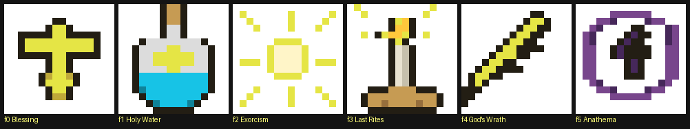
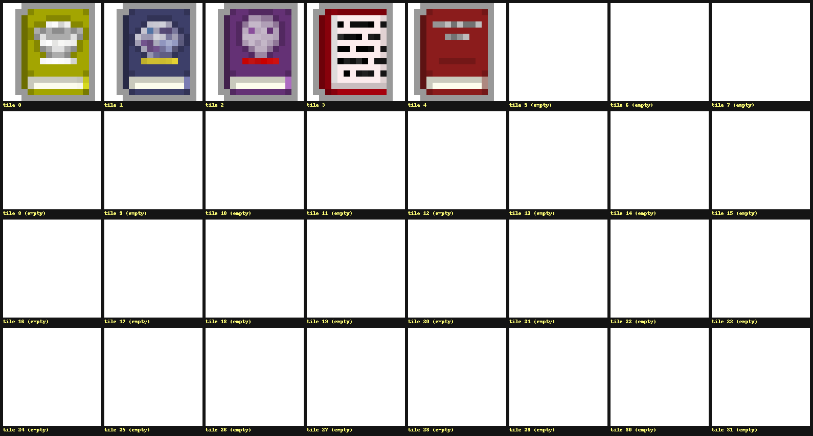

# Priest spells and spellbook icon format — final, 2026-11-09

Companion to [priest_graphics_review.md](priest_graphics_review.md) and
[priest_spells_balance.md](priest_spells_balance.md). Every stat below re-verified against the
spell scripts and a live PRIEST run via `/debug/lua_eval` on 2026-11-09.

## The priest spell set

Seven spells are grouped under the Priest affinity — `scripts/spells/CustomSpellsList.lua`:

| Spell | Lv | SP cost | Cast time | Cooldown | Targeting | Icon | Script |
|---|---|---|---|---|---|---|---|
| Blessing | 1 | 4 | 0.5 | 15 | char (any, incl. self) | `spellsIcons/priest.png` f0 (cross in mandorla glow) | `scripts/spells/Blessing.lua` |
| Heal | 2 | 5 | 1.0 | 3 | char (any, incl. self) | `spellsIcons/witchcraft.png` f2 | `scripts/spells/Heal.lua` |
| Holy Water | 2 | 5 | 1.0 | 3 | cell | `spellsIcons/priest.png` f1 (gold crucifer flask) | `scripts/spells/HolyWater.lua` |
| Exorcism | 3 | 7 | 1.0 | 6 | char, not self | `spellsIcons/priest.png` f2 (holy glow) | `scripts/spells/Exorcism.lua` |
| Last Rites | 4 | 10 | 2.0 | 12 | cell | `spellsIcons/priest.png` f3 (praying saint, halo) | `scripts/spells/LastRites.lua` |
| God's Wrath | 4 | 9 | 1.5 | 15 | char, not self | `spellsIcons/priest.png` f4 (golden flame) | `scripts/spells/GodWrath.lua` |
| Anathema | 3 | 7 | 1.0 | 20 | char, not self | `spellsIcons/priest.png` f5 (violet cross seal) | `scripts/spells/Anathema.lua` |

The icon sheet is fully bespoke and fully consumed — six frames, one spell each, in sheet
order: cross-in-mandorla → crucifer flask → holy glow → praying saint → golden flame →
violet cross seal.

2026-11-12: full bespoke rework of all six frames delivered by Mike (see the 2026-11-12
addendum for the matching effect changes — God's Wrath is now holy fire, not a bolt).

2026-11-09 changes: the wrath school (God's Wrath, Anathema) added; Blessing retargeted from
self to any char with an unholy rebuke branch; f1/f3 de-duplicated from the in-game items they
were copied from (f1 was a restyle of the `items.png:56` potion, f3 was a byte-exact copy of
the Mind Vision candle, `items/candle.png:0`).

Note: Heal.lua declares `magicAffinity = "Witchcraft"` — the Priest grouping comes solely from
CustomSpellsList, not from the spell's own desc. Its icon is on the witchcraft sheet, not
`priest.png`. If Heal is meant to be a priest signature spell, both fields may deserve a pass.

### Effects (scale with `skillLevel`, the mastery stat)

- **Blessing** — Blessed buff for `20 + 10 × skill` turns; buff level `1 + skill/3` (each buff
  level = +1 attack and defense skill). Cast on any char (allies/self get the grace; Mike's
  2026-11-09 ruling) — **undead and demons cannot receive it: they get Slow 3 instead** (the
  unholy rebuke branch, no damage). Gold shaft particles, snd_ray.
- **Heal** — heals `target.ht / 5 × skill` (min 1). No affinity gate, friendly or self.
- **Holy Water** — 3×3 splash around the target cell; undead take `4 + 3 × skill` and Slow 3.
  Nothing happens to non-undead (steam particles still show). snd_water.
- **Exorcism** — `6 + 4 × skill` damage; doubled vs undead, which also get Slow 5. Gold shaft
  burst on the target (2026-11-12: was ShadowParticle.UP, whose dark wisps contradicted the
  sunburst icon). snd_ghost — the expelled spirit.
- **Last Rites** — every undead within distance 2 of the cell takes `5 + 5 × skill` and
  Cripple 5. Gold shafts on each hit mob, LIGHT flash at the cell. snd_bones. Largest AoE,
  highest cost and cast time.
- **God's Wrath** — `10 + 5 × skill` damage to any single foe, **universal** (no undead/demon
  bonus — that stays Exorcism's identity). Pillar of holy fire: FlameParticle burst + gold
  shaft burst on the target, then the holy hit is applied directly; friendly targets are
  refused. snd_burning. (2026-11-12: was a `CharUtils:lightningProc` bolt + snd_lightning —
  reworked to match the flame icon.)
- **Anathema** — marks the target with the Anathema lua buff (`scripts/buffs/Anathema.lua`,
  auto-discovered): it takes **+50% damage from every source** for `10 + 5 × skill` turns
  (`15 + 5 × skill` vs undead/demons). Buff icon reuses BuffIndicator.MARK (27). Shadow
  particles, snd_cursed.

### Related but not spells

- **Sanctify** — PriestArmor class-armor special (`PriestArmor.doSpecial`): radius-2 holy burst,
  `5 + hero lvl` damage, full vs undead, half vs demons, then Blessed for 20 turns at level
  `1 + lvl/5`. Not a Spell object, not castable from a book.
- **Bishop NPC** — sells lesser/greater blessings directly (Blessed 100 / 500 turns) through its
  dialog (`scripts/npc/Bishop.lua`), bypassing the spell system.

### Resource and gating mechanics

- Resource is the SP pool ("mana"): priest starts 12/12 (`initHeroes.json` `sp`/`maxSp`).
  Each hero level-up: maxSp +1 and +maxSp/3 SP; PotionOfMana / ManaPotion restore maxSp/3.
- Casting spends `spellCost` SP (`enoughSP` gate); cooldown is turn-based (`spellsUsage`
  accumulates scaled turn time per Char tick, `canCast` requires ≥ cooldown); `castTime` turns
  are spent when the target is picked (`SpellCellSelector`/`SpellCharSelector`).
- Spell level gates availability: `WndHeroSpells` hides spells with `level > hero skillLevel`.
  skillLevel starts at 1 and grows only via TomeOfKnowledge reads (+1; sold in the town shop),
  so the lv2–4 priest spells unlock through tomes.
- The priest starts with Blessing in a quickslot (`initHeroes.json`).
- Undead checks use `Char.isUndead()`; Sanctify additionally keys on the `demon` flag.

## Spellbook icon format

### How a spellbook renders

`SpellBook` (`items/artifacts/SpellBook.java`) is an Artifact holding a spell name string:

- inventory/bag icon: `imageFile = "items/books.png"`, `image = 3` — one fixed tile for **all**
  spellbooks, identified or not;
- while the book is unidentified, the targeting prompt shows the book tile instead of the spell
  icon (`Spell.castIcon`); reading (`AC_READ`, must be equipped) casts the bound spell and
  identifies the book, after which name/desc reveal the spell (`Spell.identifySourceBook`);
- there is no state where the book icon is replaced by the spell icon in inventory — the spell
  icon only appears in the spells window (`WndHeroSpells`) and quickslot.

### Sheet format requirements

- `items/books.png` is a single-row strip: 512×16 RGBA = **32 tiles of 16×16**, framed by
  `TextureCache.getFilm(texture, 16, 16)` (ItemSprite standard size).
- A spellbook icon must therefore be: **16×16 px, RGBA, transparent background**, occupying
  exactly one tile — no extra height, no second row (the film crops a 16px row only).
- To give a priest book its own icon: draw into any empty tile (5–31) and set `image` to that
  index. Tiles 0, 2 and 4 contain art with no in-repo consumer (only tile 1 = TomeOfKnowledge
  and tile 3 = SpellBook are referenced) — reusing those is also safe, but an empty tile avoids
  collisions with mods that may have adopted them.

- Style: match the neighbors — chunky dark outline, saturated cover color, small pale label
  block at the bottom of the cover. A priest/divine book reads best as the gold/cream + cross
  language of `spellsIcons/priest.png` (e.g., cream cover, gold orthodox cross, dark outline).
- Wiring options, in order of cleanliness:
  1. **Java subclass** of SpellBook overriding the initializer block (`image = N`) — the
     TomeOfKnowledge pattern (`items/books/TomeOfKnowledge.java`), plus ItemFactory
     registration if it needs its own kind.
  2. **Lua/json item** — `item.init` desc accepts `image` and `imageFile` (CustomItem reads
     both, see `CustomItem.java` and docs/modding.md example) — zero java, suitable for a mod
     or a quick prototype.
- The `spell` field is `@Packable`; a transmuted book (`WaterOfTransmutation`) is created with
  no spell set, and `getSpellByName` falls back to a **random Common spell** for the unknown
  name — currently the only way books enter the world without a bound spell. A priest book
  should set its spell explicitly (constructor or `spell("Blessing")`).

## Observation

`SpellBook` currently has no in-repo way to bind a specific spell (only transmutation creates
one, and it binds nothing). If a priest spellbook (e.g., "Divine Codex" casting Blessing) is
planned, the icon slot is ready (empty tiles 5–31) and the binding needs one constructor line.

## Status — 2026-11-09 round

| Item | State |
|---|---|
| Wrath school (God's Wrath + Anathema) | implemented, live-verified |
| Blessing retarget + unholy rebuke | implemented, live-verified |
| Icon sheet 64→96 (f4 bolt, f5 seal) + f1/f3 de-dup | implemented, live-verified |
| Tests | `tests/http_api/test_priest_spells.py` 10/10 (incl. rebuke branch, +50% amplification, persistence across level transitions, friendly guard) |
| mod_compat_sweep.sh | PASS 7/7 mods, 1138 kinds, 0 ctor fails |
| memory_leak_check.sh | PASS ×2 (sheet widening, f1/f3 rework) — 0 MB floor spread both runs |
| L10n | en + ru source XML updated, LanguageTool-clean; generated `strings_*.json` regen via `make_json.py` |
| Commit | **pushed a688d67a1** (2026-11-09) |

## 2026-11-12 addendum — gold shafts

Mike delivered reworked affinity icons (ui_icons12x12 f20 outlined gold ankh, ui_icons6x6 f20
solid gold cross, applied from the RustDesk transfer) and a full bespoke rework of
`spellsIcons/priest.png` (pending transfer). Icon-vs-effect audit found one mismatch: Exorcism
(sunburst icon) burst ShadowParticle.UP — the dark-curse language — fixed to the light-shaft
family, then Mike ruled the school's shafts **gold**: `ShaftParticle.GOLD_FACTORY`
(color 0xFFE200 = icon gold; the white FACTORY now pins 0xFFFFFF per emit so pooled particles
can't leak a tint across emitters). Gold users: Blessing (both branches), Exorcism, Last Rites
(per-mob), God's Wrath, Sanctify (`PriestArmor`), Bishop blessing services. White by design:
Moongrace, Sungrass, Foliage, WaterOfHealth, DewVial, Health buff, SpiderMind. Suite 10/10 +
sweep 7/7 rerun on the fresh jar; gold render pixel-verified live on desktop (sewer, zombie
target, additive gold ≈ 226,206,51 on stone).

Open proposals from the balance review (separate round, Mike's call): Holy Water universal
splash, Exorcism demon clause, Last Rites universal ring, Heal divine identity fix, Blessing
curve `1+skill/2`, Sanctify Blessed on `skillLevel`, MagicArrow outlier cap.
